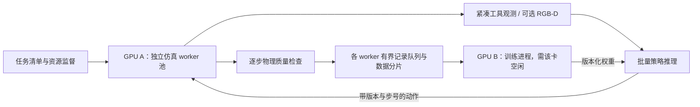

# A100 并行软组织仿真：代码审计与实施设计

本目录是隔离试验区。正式 release、原生求解器、环境依赖、GPU compute mode/MIG、网络配置均不修改。

测试版本：release `0643e10991cf61987250746da4171801c81e742b`；原生基线 `contact-groups31`，库 SHA256 `a12b75cddc340bbff1a8b24f7bd8cc4c0d010dbd20cc9b8bafab176235c89cf2`。后续候选库未因本轮测试而替换默认版本。原生实际构建源码由 CMakeCache 解析为 `endoscopic_tissue/outputs/a100-migration/contact-groups31/source`，逐文件审计见 source-audit.json，代码入口与调用链见 [SOURCE_MAP.md](SOURCE_MAP.md)。

## 实现与实际适用范围

- `benchmark.py`：独立 subprocess worker、GPU UUID 固定、跨本工具互斥锁、启动屏障、CPU 亲和性、单线程 BLAS、GPU/主机资源监测、超时和仅终止所属进程的清理。
- `worker.py`：复用已有 validate_damage 和 NativeEnvironment，不更改材料、dt、子步、接触、起切规则、完整表面检查或质量阈值；记录最终节点及连接。
- `mps_benchmark.py`：可选、临时、私有用户 MPS 对照。使用专属管道和日志目录；不设置 EXCLUSIVE_PROCESS、不配置 MIG，结束后退出本次 daemon。
- `parallel_env.py`：实验性异步 reset/step 接口。每个环境一个 spawn 进程、一个在途请求、独立原生上下文和 EpisodeWriter；动作附带请求号，观测附带 episode_id/step_id；完整状态在 worker 内保存，紧凑工具观测回传策略端。当前试验接口限定最多 16 workers，容量仍需通过显存/主机内存准入。
- `test_pool.py`：两种材料参数、不同动作、仅重置一个环境而另一个继续推进、每 worker 8 步及独立重置后的两步（2 workers 为 18 条、16 workers 为 130 条）和 EpisodeReader 哈希/窗口验证。属于接口测试，不替代完整切割验收。
- `analyze.py`：从保留的原始结果重算性能表、最终节点差异与连接合法性。

当前脚本操纵一把夹钳和一把剪刀的末端位姿，不包含两套完整机械臂的关节动力学与全臂碰撞。墙面基线是辅助锚点夹持模式，不把它的成功外推为纯摩擦重抓成功。材料未临床标定，本次验证的是相同数值模型和既有验收规则下的并行一致性。

## 三种路线的代码结论

| 路线 | 当前可直接实现的内容 | 限制与改造成本 |
|---|---|---|
| A：一个 Scene 多份组织 | 可以显示多份网格；一个原生网格也可包含互不连接的材料部分 | 独立组织仍共享一套 g_tool、剪刀、材料参数、拓扑计数和缓存；不能因此得到独立完整任务。需多 context 或批量原生求解器。空间拉开只解决部分碰撞问题，不解决状态/重置所有权。 |
| B：Genesis n_envs | Genesis 原生 FEM 有 _B 维度及按 env 的计算 | 本项目 NativeTissue 经 ctypes 调用 LCS_*，没有接入 FEM solver，也没有 env_id/context 参数。不能由 Scene.build(n_envs=N) 复制切割引擎。需要重入 ABI、逐环境数据与动态拓扑支持。 |
| C：多个进程 | 每个进程具有自己的库静态变量、CUDA 上下文和 Python 环境，可分别 reset/step | 可复用原库，改动最少。普通 CUDA 上下文间主要时间片调度，CPU 检查可以并行；MPS 是否有额外收益须实测。 |

证据入口：`native_backend.py:214` 的 active_session 明确拒绝进程内第二会话；`physics.cu:72` 起存放静态物理缓冲区；`cut.cu:44` 起存放切边、切点、单个拓扑版本，`cut.cu:108` 为单工具；`dc_recon.cu` 为单网格尺寸/表面计数器；`xpbd_solver.cu` 的 g_N、g_tool、接触状态和 CUDA Graph 句柄也是全局。删除 active_session 检查会暴露覆盖/释放对方状态风险，不能视为支持多环境。

在 C 中，不同场景几何、材料、动作与切割进度属于不同进程，可独立配置；参数变化仍需各自物理验收。标准 11 维动作是夹钳 xyz+开合、剪刀 xyz+三个角+开合，夹钳方向在当前动作空间中固定。随机 seed 本身不会让预设脚本自动生成不同任务。

## 设备与约束

实际设备为 A100 **80GB PCIe**，驱动 580.95.05。GPU0 在预检时已有其他用户任务、约 72GB 显存；只使用空闲 GPU UUID `GPU-c1c4c0d5-5b39-9b0e-84a0-a667e65484fa`。两张 A100 拓扑报告为 PIX，当前没有显示 NVLink 互联，不能套用 SXM/NVSwitch 结果。

每进程限制一个指定逻辑核和单线程 BLAS，初始测试最多使用 8 个物理核对应的逻辑 CPU，另做 16 环境 / 16 核对照；整机共有 152 逻辑 CPU。测试期间其他用户 CPU 负载较高且随时间变化，绝对速度和最佳并行数只能解释为本轮共享服务器条件下的观测。普通/MPS 的单批差值不是严格 ABBA 控制试验，不能将所有差值归因于 MPS；正式签署应在有 CPU 资源保障的条件下重复配对。GPU0 从未用于本轮测试。

A100 有 108 个 SM；80GB PCIe 型标称 HBM2e 带宽 1935 GB/s、FP32 19.5 TFLOPS。当前审计未找到 WMMA/mma.sync/cuBLAS GEMM 调用，因此不能把 Tensor Core 宣传算力直接当作该求解器吞吐量。利用率低也不等于可以按比例增加环境：需要区分核函数占用、主机发射空隙、同步及 CPU 几何检查。

## 基准方法与指标定义

统一 1mm 墙面网格：76,050 总节点、30,417 材料节点、38,425 活动节点；一回合完整 1,440 个步骤，其中 reset 准备 30 步、记录转换 1,410 条。dt=1/30，3 子步；关闭渲染，保留原完整质量检查。开启逐核 section profiling 的运行单独标记，不与正常吞吐计时混合：该 profiling 会绕过部分 CUDA Graph 并增加事件同步。

- 单环境速度：该 worker 完成的步骤 / 该 worker 的实际回合墙钟时间。
- 总吞吐：所有 worker 完成的步骤总和 / 从统一 GO 到整批结束的墙钟时间。包含 reset、原质量检查和结果写出；不包含启动屏障前的 Python import。
- 有效 episodes/hour：本批通过完整质量检查的回合数 ×3600 / 同一墙钟时间，是短批次折算，不能宣称完成了小时级稳定性测试。
- 吞吐基准保存逐步质量/动作摘要和最终网格，未逐帧写完整网格或 RGB-D；完整 EpisodeWriter 落盘仅做接口集成短测，不能将基准 episodes/h 当作已验证数据采集/训练速度。
- 任何失败、提前结束、启动失败和资源拒绝均保留。settle-only 测试不能计入有效完整回合。
- GPU 利用率和显存每约 2 秒采样，峰值是采样峰值，不是分配器精确高水位；NVML memory utilization 表示访存忙碌采样，不是实测 GB/s。
- `quality_and_export` 已包括 `surface_export`，不得重复相加；日志中的 `snapshot` 是 Python 观测整理，不是持久化状态快照。
- 节点和拓扑最终对照用于定位差异；切割后的 GPU 原子顺序可引入非逐位重复性。物理验收首先依赖原阈值和逐步指标，不能将逐位不等直接解释为跨进程污染。

## 瓶颈与最小改造路线

1. **先保持求解器，使用进程池。** 独立进程避免重入风险；策略端异步收取完成的环境，避免最慢环境阻塞全批。重置与输出也各自独立，不使用 fork 继承已初始化 CUDA。
2. **控制 CPU 检查与数据成本。** NumPy/SciPy 表面几何、连通性检查、观测数组复制在 CPU；导出涉及设备到主机同步。先按同一步复用已经得到的表面/数组，并逐项比对原检查输出；不要为 FPS 降低检查频率或阈值。本轮没有改这些检查。
3. **MPS 是独立优化项。** 普通多进程和 MPS 分别实测，MPS 不保证线性提升；受 GPU 核函数资源需求、CPU 供给和驱动约束。共享 MPS 下故障影响范围可能扩大，仍需要 worker 超时和失败记录。
4. **有证据后再做 context 化。** 新增 `LCS_Create/Destroy(ctx)`、所有 `LCS_*` 显式 ctx；将 physics/cut/recon/haptics/xpbd 的 mutable 静态状态移入上下文，拥有各自 stream、计数器、拓扑 revision、graph、scratch。首先只验证两个 context 串行交错与单独 reset，再考虑 stream 并行；不是简单多开 Python 对象。
5. **真正批量化最后做。** 规则网格用 env-major 数组或分段偏移，kernel 增加 env_id；每环境的节点、邻接、切点、重建三角面、接触对、计数器和容量独立。不同切割拓扑意味着不能共享动态邻接/计数；溢出必须逐环境显式失败。独立重置要清理该 env 的力、历史、接触缓存、切割计数和 graph 依赖。先固定尺寸、同类墙面场景，验证后才支持异构几何。

原生重入改造涉及跨多个 CUDA 翻译单元的状态所有权和生命周期，收益尚无测量，不承诺开发天数或倍率。当前已有 Graph 和局部 GPU 并行，批量化主要可能减少小 kernel/同步空隙；不能假设能减少每个环境本来必须执行的接触和切割工作。

## 训练与数据流设计

图中完整 GPU B 训练/推理部署是设计方案；本轮实际实现和测试的是仿真进程池、紧凑观测传输与本地数据写入。

RL：使用现有奖励/终止语义和 bootstrap_allowed，保存实际执行动作而不只保存策略目标。按物理有效性过滤；超时与 native failure 不伪造下一状态。初期可在采样卡上做小批推理，或用另一张可用卡集中推理/训练，测量队列延迟后选择。完整训练循环与模型吞吐本轮不伪造测量。观测只含工具/可选传感器信息，未暴露全部内部速度、摩擦与断裂历史，不能把它当作完整 Markov 状态；若算法需要，可使用观测历史或显式扩展观测合同。

自监督/世界模型：保留动作、时间步、相邻状态、拓扑版本、单位、相机同步和质量标记；按 reset lineage、几何家族和材料设置分组，避免同一初始快照的分支跨训练/测试泄漏。完整物理数组本地压缩分片，策略端默认不通过 IPC 搬运全网格；需要视觉时单独测渲染器显存和帧率，可先状态采集后离线渲染。

双 GPU：若两卡都空闲，独立 episode 分片到两张卡通常无需跨卡物理通信，但总吞吐受共享 CPU/存储约束，不能预先声称 2 倍；若同时训练，可一张采样、一张训练并做异步权重发布。当前另一张 A100 已被占用，未进行双卡实测，也未使用其余 V100。

## 训练接入时的具体约束

| 工作负载 | 建议调度与记录方式 | 本轮验证程度 |
|---|---|---|
| PPO 等同策略 RL | 一批采样固定策略版本；按有效 transition 数收集 rollout；异步环境完成后立即补发动作，更新前处理版本一致性 | reset/step 与请求顺序已实现；策略网络、优化器、优势估计未接入 |
| 离策略 RL | 有界 transition 队列、版本化策略快照；保留终止/截断与 bootstrap_allowed，不把无效物理转移混入正常 replay | 数据窗口与哈希读取已测试；实际 learner 吞吐未测 |
| 自监督 / 世界模型 | worker 本地压缩 episode 分片；manifest 记录库 SHA、材料、几何、种子、动作版本、拓扑版本、质量；按 reset lineage 划分训练/验证集 | 完整状态只做短程落盘测试；RGB-D 与长程存储吞吐未测 |
| 两卡共同采样 | 每卡独立监督器和 episode 分片，GPU UUID 固定；汇总队列有界，CPU 核和文件目录分别分配 | 设计方案，第二张 A100 被占用，未实测 |
| 一卡采样 + 一卡训练 | 先使用 8 环境采样配置，测量推理排队后再决定升到 16；异步发布带版本权重 | 设计方案，未测模型计算与仿真竞争 |

完整 EpisodeWriter 当前在 worker 内同步落盘；若实测存储成为瓶颈，再引入有界写队列及退出时 flush，不采用无限内存缓存。不能为了吞吐静默丢帧或降低物理验收。

## 官方依据

- [A100 数据表](https://images.nvidia.com/data-center/a100/a100-datasheet.pdf)：PCIe/SXM 显存带宽及硬件规格。具体服务器拓扑以本地 nvidia-smi 为准。
- [Ampere 架构详解](https://developer.nvidia.com/blog/nvidia-ampere-architecture-in-depth/)：A100 的 SM 布局。
- [NVIDIA Ampere 调优指南](https://docs.nvidia.com/cuda/ampere-tuning-guide/index.html)：资源占用、访存与主机设备传输原则。
- [NVIDIA MPS 架构](https://docs.nvidia.com/deploy/mps/architecture.html)：普通上下文时间片、MPS 并发调度与地址空间。
- [MPS 环境变量](https://docs.nvidia.com/deploy/mps/appendix-environment-variables.html)：UUID、私有管道及资源配置。网页可能介绍新驱动能力，本轮仅使用本机 580 驱动实际提供的 legacy 控制接口。

硬件容量估算只针对固定的无渲染墙面基线。肾脏大网格、真正双臂机器人、RGB-D 渲染和模型推理会额外占用显存/算力，不得套用同一个并发上限。

性能与最终推荐见同目录 `REPORT.md`、`performance.md` 和原始 `runs/`；未执行的规模应明确标为未测，不能填写预测值充当实测。
