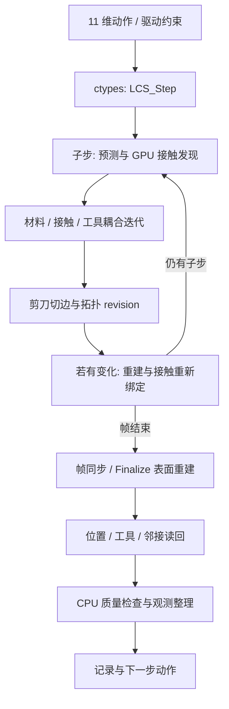

# 代码证据入口

原生条目指向 CMakeCache 所记录的实际构建源；不是仅根据当前 native/ 目录推断。静态计数和 SHA256 在 source-audit.json。

| 证据 | 源码 | 结论 |
|---|---|---|
| 会话唯一性 | [native_backend.py:214](/srv/disk2/hryang/genesis-exec/releases/0643e10991cf/endoscopic_tissue/native_backend.py:214) | active_session 拒绝第二个原生会话；只删除此检查会让 native 静态状态互相覆盖。 |
| 物理步与读回 | [native_backend.py:375](/srv/disk2/hryang/genesis-exec/releases/0643e10991cf/endoscopic_tissue/native_backend.py:375) | command → LCS_Step → LCS_Finalize → RefineContactSurface → observe；每步读回位置、工具、载荷；拓扑版本变化时读邻接。 |
| Genesis 使用方式 | [rendering.py:270](/srv/disk2/hryang/genesis-exec/releases/0643e10991cf/endoscopic_tissue/rendering.py:270) | gs.cpu 初始化轻量显示 Scene；软组织物理通过 ctypes 原生库执行。 |
| 训练质量路径 | [env.py:266](/srv/disk2/hryang/genesis-exec/releases/0643e10991cf/endoscopic_tissue/training/env.py:266) | 每步材料质量、表面导出、QualityMonitor；CPU 检查不能由 GPU batched Scene 自动并行。 |
| CPU 连通性检查 | [quality.py:5](/srv/disk2/hryang/genesis-exec/releases/0643e10991cf/endoscopic_tissue/training/quality.py:5) | SciPy sparse/connected_components 与 NumPy 几何检查属于每进程 CPU 工作。 |
| C ABI | [plugin_api.cpp:23](/srv/disk2/hryang/genesis-exec/releases/0643e10991cf/endoscopic_tissue/outputs/a100-migration/contact-groups31/source/vendor/src/plugin_api.cpp:23) | 导出 LCS_* 不接收 ctx/env_id；工具、初始化、重建转发到单实例模块。 |
| 帧与切割同步 | [physics.cu:352](/srv/disk2/hryang/genesis-exec/releases/0643e10991cf/endoscopic_tissue/outputs/a100-migration/contact-groups31/source/vendor/cuda/physics.cu:352) | 固定子步循环；每个子步后 cut_ribbon_tick；revision 改变则在下一个子步前重建并重新绑定接触。末尾 cudaDeviceSynchronize。 |
| 接触发现 | [xpbd_solver.cu:3135](/srv/disk2/hryang/genesis-exec/releases/0643e10991cf/endoscopic_tissue/outputs/a100-migration/contact-groups31/source/vendor/cuda/xpbd/xpbd_solver.cu:3135) | GPU 按表面/接触组分类与接触生成，随后流形及统一迭代。 |
| 材料/接触求解 | [xpbd_solver.cu:3209](/srv/disk2/hryang/genesis-exec/releases/0643e10991cf/endoscopic_tissue/outputs/a100-migration/contact-groups31/source/vendor/cuda/xpbd/xpbd_solver.cu:3209) | direct profiling 分支与 CUDA Graph 路径；CG、粗模式、局部扫掠、工具约束交织，不宜拆成互相独立的材料和接触时间。 |
| 变形后切割 | [cut.cu:44](/srv/disk2/hryang/genesis-exec/releases/0643e10991cf/endoscopic_tissue/outputs/a100-migration/contact-groups31/source/vendor/cuda/cut.cu:44) | 静态切边/切点缓存、拓扑版本和工具状态；GPU kernel 内有节点/边并行，没有 env 维度。 |
| Genesis 自有 FEM | [fem_solver.py:1](/srv/disk2/hryang/genesis-exec/releases/0643e10991cf/genesis/engine/solvers/fem_solver.py:1) | 该 solver 自有 _B 批量维度；与当前自定义 native backend 是两条物理路径。 |

当前一步的数据流：

这里是单环境内的 GPU 并行。多进程让每份上述状态各归一个进程持有，MPS 再允许不同进程的工作在 GPU 上交错/并发执行；没有把单环境全局数组变成一份共享批量数组。
