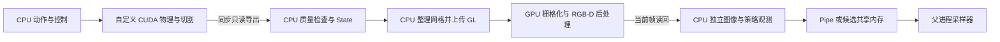

> GitHub 归档说明：本页结论保持原样。部分逐帧 JSON 链接已改为带原文件 SHA256 的指标摘要；原始 trace、编译库、环境和大型快照仅保留在服务器。详见 [归档范围](../GITHUB_ARCHIVE.md)。

# Genesis 软组织仿真性能分析与优化

> 2026-11-04 原生核心专项已完成：同库交错原核约21.50Hz，最终双器械合批和精确材料缓存约23.03Hz，P95 50.42ms、最慢20帧18.45Hz。稳定20Hz及完整物理域仍未通过，正式入口未替换。详见[原生核心最终报告](native-core-20261104/REPORT.md)及其补丁、时间线和复现入口。

> 2026-11-04 后续激进优化已完成：同条件原版15.57/15.66Hz，候选21.45/21.42Hz，P95约57.1ms，稳定20Hz仍未通过。新报告与最终独立代码见[实时性专项报告](aggressive-20261104/REPORT.md)。正式版本未替换。

状态：定量剖析、分阶段实现、完整场景、双 worker 性能测试与同状态视觉回归已完成。**未通过稳定 20 Hz 和完整物理域验收，不替换正式版本。最终隔离候选为 V4；V5 共享内存和早期 UV 缓存仅保留实验归档。**

本轮同条件重测证明主要收益来自图像后处理和 CPU 数据整理：V1 完整 RGB-D 从重复基线约 8.33 Hz 提升到 11.84 Hz；最终 V4 的训练 RGB-D（另含深度对齐及观测复制）为 11.16 Hz，P95 120.35 ms；双 worker 完整图像 IPC 总吞吐为 12.65 steps/s，每环境约 6.32 steps/s。不同口径不相互替代，也不能直接与历史 11.60 Hz 跨运行比较。

**瓶颈不是 80 GB 显存不够，也不是单纯 GPU 使用率低**：单环境卡级峰值约 2.1 GiB，双 worker 约 4.1 GiB；GPU 原生约 33–36 ms，CPU 检查/状态生成、渲染前后处理及 IPC 的串行成本使完整帧显著超过 50 ms。保留全部失败与资源扰动记录；没有通过降分辨率、减少子步或关闭检查达标。

## 测量范围与可复现条件

硬件为服务器第二张 NVIDIA A100 80GB PCIe，UUID `GPU-c1c4c0d5-5b39-9b0e-84a0-a667e65484fa`。另一张 A100 有其他作业，未使用；服务器其余卡是 V100，不将其结果混入 A100 对照。仅在选定卡空闲时启动，保留后台 GDM Xorg 的 4 MiB 上下文记录，对其余外来计算/图形进程执行退出守卫。未安装依赖、修改时钟、启动 MPS、调整系统权限或网络。

原生库固定为 `../native-s25/build/lib/libLiverCudaSim.so`，SHA256 为 `3950d6219d57bb9a7bd8770c62365c08590662cb10688f94d939705195645f4c`。旧库的 `binary_source_binding` 仍是 `unverified_prebuilt_binary_kept_as_independent_baseline`，本轮保留此限制，没有声称已重建验证源码和二进制完全对应。本轮没有修改 CUDA 物理求解、材料参数、时间步、子步、求解迭代次数、切割判定、质量阈值或检查频率。候选只在本目录，冻结版本及补丁见 [README](README.md)、[changes-v4.json](changes-v4.json)、[candidate-v4.patch](candidate-v4.patch)。

完整固定脚本使用 nominal `wall-traction`、settled 初始化后的全部 1410 步；保持 S19、S22、完整表面检查及已有 fast topology 检查。分辨率 1280×960，supersample=1，与历史 11.60 Hz 的测试一致；不是把默认 UI 的 supersample=2 下调。CPU 亲和性固定为同 NUMA 的 `7,19,20,25`，BLAS/OMP=1、OpenCV=4。没有为本任务独占服务器 CPU，其他用户负载会影响绝对耗时。

分开报告四种口径：

1. **物理与检查**：原生物理、接触、切割、表面导出、全部启用的检查和状态生成，不含图像。
2. **完整 RGB-D**：上述工作 + 每步网格更新、1280×960 全新 RGB-D、图像回读到 CPU。这与历史 11.60 Hz 的主基准一致。
3. **训练 RGB-D**：再包含深度对齐、有效性掩码、RGB 转换和策略观测图像复制。实际池测试进一步包括管道序列化、传输和父进程接收。
4. **密集 S25 标签**：再包括分割、可见三角形/重心坐标、24 槽材料支撑 ID/权重、仿射偏移和无效掩码。历史 11.60 Hz 不包含这些密集标签。

均未声称覆盖视频编码、网络、远端屏幕呈现或学习器更新。初始化/JIT 不进入逐帧 FPS，但进程总时长和资源日志保留。短窗口 profiler 测量只用于归因，不能充当整段 FPS 或 20 Hz 验收。

## 实际执行和数据流

节点、约束与物理内部状态已有 GPU 常驻数组；主要 CPU↔GPU 往返位于导出检查与网格上传，图像原版还要在 CPU 进行全图后处理。V4 把这部分移到同一个 OpenGL pass，而非先读回、转为 Torch/CUDA tensor、再上传 GPU。没有异步返回上一帧，没有减少检查或图像频率。图中学习器不在本次实际测试链内。

## 先测到的瓶颈

### 未插桩的端到端分解

第一轮重复基线 A1/A2 各完整 1410 帧，平均 119.78/120.32 ms，约 8.35/8.31 Hz。以下是 A1 的互不重复的阶段计时，百分比以完整帧为分母：

| 阶段 | 平均 ms/帧 | 完整帧占比 | 主要执行位置 |
|---|---:|---:|---|
| 原生物理 step，含其同步观测 | 34.65 | 28.93% | CUDA + CPU API 等待 |
| 质量检查及表面导出 | 27.95 | 23.34% | 主要 CPU；包含原生 GPU 读回 |
| Python 状态生成、抓取证据 | 5.72 | 4.77% | CPU |
| 网格更新 + RGB-D 渲染/后处理/回读 | 50.49 | 42.15% | CPU + OpenGL GPU |
| 控制、策略小观测及其他边界 | 0.97 | 0.81% | CPU |
| 合计 | 119.78 | 100% | wall-clock |

`quality_and_export` 已包含 `surface_export`，不能再次相加；`state.snapshot` 是每步 State 生成，**不是每帧执行完整原生存档/压缩**。抓取证据计算包含在 State 生成中。

### CPU 函数细分

60 帧 incise_1 窗口（全局帧 470–529）同时采集 cProfile、NVTX、线程 CPU 时间和 Nsight。插桩后完整帧 156.58 ms，不能当运行速度；同一窗口的父子耗时如下：

| NVTX 范围 | wall ms/帧 | 线程 CPU ms/帧 | 注意 |
|---|---:|---:|---|
| native.step | 51.45 | 50.40 | 包含下面的 LCS_Step |
| LCS_Step | 45.59 | 44.70 | CPU API 等待覆盖大量 GPU 计算 |
| LCS_Finalize | 0.61 | 0.60 | 还会产生后续 GPU 活动 |
| quality.all | 37.04 | 36.24 | 包含表面检查、仪器距离等子项 |
| quality.assess | 28.32 | 27.75 | 包含节点检查、拓扑、组织/工具检查 |
| quality.topology | 8.33 | 8.23 | CPU 哈希/几何统计 |
| quality.tissue_tool_overlap | 7.57 | 7.35 | NumPy 几何筛选、精确采样 |
| quality.instrument_distance | 5.54 | 5.39 | CPU 仪器包围体几何 |
| state.snapshot | 6.32 | 6.31 | 包含约 4.47 ms 抓取证据计算 |
| render.update_mesh | 13.78 | 13.63 | CPU 属性整理及 GL buffer 更新 |
| render.rgbd | 45.37 | 43.82 | 包含 GL 与 CPU 图像处理 |
| cv.remap | 10.29 | — | 原版 CPU 畸变校正 |
| cv.multiply | 6.55 | — | 原版 CPU 渐晕 |

原始证据：[CPU spans](results/baseline-profile/cpu-spans.json)、[cProfile](results/baseline-profile/python-profile.txt)、[CPU trace](results/baseline-profile/cpu-timeline.json)。这些范围有嵌套关系，不能纵向求和。

### GPU 真正执行、API 等待与时间线

另取帧 470–481 进行 CUDA Graph **节点级**采集；未省略任何窗口前物理步，只在短剖析的窗口前减少渲染以节约准备时间。此窗口 wall 平均 99.87 ms：

| GPU 活动 | 区间并集 ms/帧 | wall 占比 |
|---|---:|---:|
| 实际 CUDA kernels | 35.672 | 35.72% |
| CUDA 传输 | 0.590 | 0.59% |
| CUDA memset | 0.700 | 0.70% |
| CUDA 全部活动并集 | 36.963 | 37.01% |
| OpenGL GPU workload 并集 | 7.313 | 7.32% |
| CUDA + OpenGL 联合并集 | 44.276 | 44.33% |

上述两个捕获的窗口长度、插桩方式和共享负载不同，**不能用 156.58→99.87 ms 推导优化收益**。60 帧捕获的 CUDA Graph 默认是包络，节点级捕获才揭示了图内部内核；仅统计普通 kernel 表会把原生 GPU 计算严重低估。

可放大 [SVG](figures/baseline-timeline.svg)，或打开 [Perfetto timeline](results/analysis-nodes/timeline.json)、原始 [Nsight 文件](results/baseline-nodes.nsys-rep)。图中 CPU 行是 API/函数调用范围，GPU 行是设备活动；二者可以重叠，不能相加。完整统计在 [analysis-nodes](results/analysis-nodes/summary.json) 和 [analysis-main](results/analysis-main/summary.json)。

CPU API `cudaMemcpy` 在节点级窗口平均 29.85 ms/帧，但实际 GPU 传输只有约 0.59 ms/帧。60 帧窗口也有同样现象：API 34.34 ms，真实传输约 0.74 ms。前者包含等待队列前序计算、驱动开销及返回，**不是 PCIe 传输了 34 ms**。原生每帧读回约 3.89 MB，H2D 约 3.32 KB，D2D 约 31.49 MB；物理主体已经常驻 GPU。

当前热路径是 ctypes 调用自定义 CUDA DLL 与 OpenGL 渲染，不是 PyTorch tensor 算子链。训练源码的 `.item()` 命中是快照序列化中的 NumPy 标量转换，未发现用 `.cpu().numpy()` 反复搬运物理 tensor 的路径。实际同步来自原生 ABI 读回、GL readback 及必要状态检查；不能只搜索 PyTorch 写法就判断传输开销。

节点捕获每帧约 49.67 次同步 cudaMemcpy、32 次 cudaMemcpyAsync；显式 cudaDeviceSynchronize 平均只有 0.060 ms API 时间，大量等待已经发生在前面的读回。每帧约一次 cudaMalloc/free，API 合计约 0.478 ms，优先级低于后处理和质量检查，不把它当主要根因。GPU 后处理 FBO、纹理、shader 和固定 lens map 常驻并复用；每帧必要的独立 CPU 输出仍分配，避免下一帧覆盖历史观测。

节点级窗口约 2457 次设备 kernel 执行/帧，其中 CPU `cudaLaunchKernel` 约 667 次/帧；其余在现有 Graph 内。`cudaGraphLaunch` 18 次/帧、API 延迟约 5.02 ms；Graph 销毁/实例化合计约 3.99 ms/帧的 API 延迟，包含等待，不能直接当成可完全消除的 CPU 成本。当前实现已有图缓存、条件图与拓扑变化后的更新；“加 CUDA Graph”不是尚未做过的新方案。

线程 CPU 时间计入驱动自旋及内存等待，不能直接解释成有效 Python 计算。服务器 `perf_event_paranoid=4`，本轮未改权限；OS run-queue/硬件 CPU 采样不可用，未把无法分辨的等待强行拆成虚假的精确数值。GPU 驱动只读配置为 `RmProfilingAdminOnly=1`；未采集 Nsight Compute 硬件吞吐/occupancy counter，寄存器数不能单独证明带宽或 occupancy 瓶颈。环境版本和权限证据见 [environment.json](results/environment.json)。

### GPU 物理细分

以下是**实际内核时间**，按名字建立不重叠分组，完整清单在 [kernel-groups.json](results/kernel-groups.json)。接触、材料和工具的耦合核无法从一个 kernel 的总时间继续精确拆分，故明确保留耦合类别。

| 内核组 | ms/帧 | 占 kernel 时间 |
|---|---:|---:|
| 显式接触搜索/流形/表面绑定相关核 | 12.379 | 34.70% |
| 耦合材料/工具求解、守卫、遥测及其余核 | 22.686 | 63.60% |
| 表面重建核 | 0.310 | 0.87% |
| 切割与连通拓扑更新核 | 0.296 | 0.83% |

最大单核为 `k_FindSurface`：9.261 ms/帧、162 次/帧，约占 kernel 时间 26%。其次是 `k_CoarseAccumulate` 3.647、`k_AssembleUnifiedInteractions` 2.388、`k_UnifiedManifold` 1.713、`k_UnifiedVertex` 1.712、`k_CoarseBound` 1.573 ms。372 次/帧的最小体积修复总共约 0.925 ms，不能仅凭启动次数判断优先级。

源码已经按 64 个三角形分组保守剔除，并保留刀背 preload/contact 的例外。后续优化接触搜索必须保留这些例外、穿透/摩擦语义及确定的迭代流程；不能通过减少接触搜索次数虚增 FPS。

### 训练视觉的额外成本

独立的 8 帧训练视觉捕获给出：完整帧 wall 216.68 ms，`vision.all` 98.88 ms，其中网格更新 15.91、原 RGB-D 渲染 50.09、深度对齐 27.55 ms；策略观测图像复制另需 3.98 ms。CUDA + GL 活动并集为 51.19 ms，不能与上述 CPU API 时间相加。该窗口包含真正的深度对齐和观测复制，区别于历史直接 RGB-D 基准。证据：[CPU spans](results/baseline-training-profile/cpu-spans.json)、[GPU 活动](results/analysis-training/summary.json)。

## 实施记录与验证

| 优先项 | 根因 | 已实现的变化 | 同条件局部实测 | 保留情况 |
|---|---|---|---|---|
| RGB-D CPU 后处理 | 多次全图 CPU 遍历、回读后重采样与深度计算 | GL 全屏 pass 在 GPU 中执行 OpenCV 固定点线性采样、渐晕、通道转换及深度线性化；原 MSAA 不变 | 同一真实切割状态，仅 render/readback 31.02→17.43 ms | 保留，显式开关 |
| 训练深度对齐（V3→V4） | 额外 CPU remap、有效性掩码、临时图像 | 在同一 GL pass 输出对齐深度与有效掩码，保留原始 pinhole 深度和全部 CPU 输出 | 同状态交替测量，完整视觉回读路径 54.89→17.28 ms，掩码逐位一致、深度差≤1.49e-8 m | 完整 1410 帧对照 9.78→11.16 Hz；保留 |
| 节点质量检查/材料连通 | 全数组布尔索引、临时数组及 SciPy 图构建 | Numba 合并归约与同义 union-find；无 fastmath | 100 组节点 + 50 组图精确对照；完整运行 quality/export 约 28→22 ms | 保留 |
| 纹理布局缓存实验 | 试图复用未变锚点的 UV | 完整 anchors/triangles/scale 校验后复用 | 静态局部 25.91→22.52 ms，但动态切割窗口 **0 命中 / 13 失效** | **V4 已删除**；V2/V3 仅归档实验 |
| 组织/剪刀检查 | NumPy 大数组几何筛选中间量 | 合并保守 broad phase；原精确 samples/窄相交计算与阈值保留 | 同一状态 3.172→2.075 ms；51 组几何结果逐项一致 | 保留 |
| 密集像素材料组合 | 24 槽 gather、浮点广播及多个百 MB 临时数组 | 单遍物化原 CPU 输出，验证和组合融合；无近似/fastmath | 1280×960 合成有效/无效混合输入 727.17→141.93 ms，逐元素一致 | 保留算法；不表示完整标签验收通过 |

GPU 图像输出对照在真实切割表面及人工形变、锚点变化、同计数索引重排四种输入进行。RGB 全部字节一致，深度最大差 `1.49e-8 m`，低于测试预先采用的 `1e-6 m` 浮点容差；未改变分辨率、采样数、近远平面或遮挡方式。证据：[render-gpu-01](results/render-gpu-01/result.json)、[render-gpu-v2](results/render-gpu-v2/result.json)。

节点检查微基准 `quality-equivalence.json` 使用真实节点坐标但将所有节点设为 active，是压力微基准，不是实际 active 分布的整帧收益。端到端收益以上方完整场景阶段计时及后续表格为准。几何与标签微基准分别见 [geometry-layout-equivalence](results/geometry-layout-equivalence.json)、[pixel-compose-equivalence](results/pixel-compose-equivalence.json)。

没有把所有 CPU 操作强搬到 GPU：24 槽密集标签按现有合同需返回约 252 MB CPU 数据，另上 GPU 再读回并不自动获益。当前融合先消除临时数组；若学习器可直接消费 GPU 张量，应设计独立 GPU 常驻合同。GPU 后处理限定已验证的 supersample=1 离屏路径，不悄悄降低默认 supersample=2；直接相机分割等调用继续走原路径。

训练 CPU 回归 116 项通过，核心几何回归 20 项通过。日志：[training](logs/cpu-regression-v2.txt)、[core](logs/core-regression-v2.txt)。这些测试不替代实际物理域验收。

实际 CUDA 正对照 [invariants-v2](results/invariants-v2/result.json) 已通过：真实 cut onset、5 次恢复的节点位置及原生存档字节完全一致；443521 个组织像素均有有效材料支撑，重投影最大误差 0.00271 px，材料点到像素中心深度最大误差 1.19e-6 m；标签/渲染前后原生存档不变，真实材料标签组合与原版逐元素一致。这是固定状态及短动作验证，不是连续全场景通过。

另外进行了同一快照的 A1/B1/A2/B2 四个 40 步关闭剪刀回放。A 使用原 CPU 渲染，B 使用 GPU 后处理；各分支检查通过，渲染前后原生存档逐字节不变。但 A/A 也不逐轨迹确定：全节点数组最大分量差约 4.00 mm，A/B 为 4.54 与 1.74 mm；切割边数 A1/A2 为 55/44，B1/B2 为 42/50。**不能把它说成逐轨迹等价已通过，也不能只凭这些样本把差异全部归因于优化或认定统计等价。** 原生浮点并行顺序及快照后续执行状态覆盖仍需单独定位；即时恢复字节相同不等于未来轨迹确定。原始证据：[replay-render-v2](results/replay-render-v2/result.json)。

## 仍然失败的功能与兼容性

本轮 V2 的完整训练 RGB-D 在第 1095 步因 `positional_nonmanifold_edges=1` 被拒绝，见 [final-vision](results/final-vision/result-summary.json)。其约 7.06 Hz 仅是失败前 1095 帧的测量，不能计作完整场景成功；没有关闭检查或继续接受坏帧。其他完整运行的切割边总数也有差异，见 [物理指标汇总](results/physical-regression-summary.json)。

原 S18 新几何重复运行不稳定、纯摩擦准备失败、S22 `wall` 仪器碰撞检查失败、真实撕裂分离正对照未触发的状态保持未通过；本轮 nominal `wall-traction` 的通过不能覆盖这些失败。`training_domain_approved` 保持 False。

本轮新增发现：原版全分辨率密集标签在全局帧 475 尝试期间失败，`LCS_GetSurfaceBindings` 返回 45246 个顶点，而当前渲染表面为 45276。原始错误在 [baseline-labels-profile/result.json](results/baseline-labels-profile/result-summary.json)，未吞掉异常或补造标签。捕获到 5 个成功帧和 1 个中止帧，因此其整体 FPS 不可作有效吞吐。

源码证据：`LCS_Step` 先执行 `recon_prepare_contact_surface()`，写入物理接触缓存的 `g_surfaceCount`；`LCS_Finalize` 随后 `recon_rebuild()` 更新重建表面。标签 ABI 用 `3*g_surfaceCount` 当导出长度，而 `surface()` 依据当前 `d_triCounter`。这解释了新增切割三角形时的数量错位；还应验证同计数重排，不仅修长度。最小修复方向是**独立只读导出当前重建数量、身份和支撑绑定**，不调用会清空/更新物理接触缓存的准备函数来掩盖问题。本轮未改原生 ABI 或物理状态。

标签剖析中 `compose_pixel_supports` 成功调用均值约 1081 ms；以 6 个尝试帧摊销为 900.60 ms（因为最后一帧在组合前失败）。`vision.all` 约 1466.62 ms/尝试帧，实际 CUDA + GL GPU 活动并集仅约 80.87 ms。这证明此路径的大头是 CPU 数据物化，不能以 GPU 利用率低推断 GPU 物理慢。见 [标签时间线](figures/labels-timeline.png) 和 [原始分析](results/analysis-labels/summary.json)。

优化后的密集标签剖析仍在第二个尝试帧失败：绑定导出顶点数 45186，而当前表面 45204。只完成 1 次像素组合调用，耗时 357.14 ms；若按 2 个尝试帧摊销则为 178.57 ms，不能把后者当每个成功标签帧成本。整体尝试帧约 721.02 ms，GPU 活动并集约 71.36 ms；虽然 CPU 组合微基准和同状态精度验证有效，**连续标签路径仍不能提供通过验收的 FPS**。证据：[final-labels-profile](results/final-labels-profile/result-summary.json)、[CPU 分解](results/final-labels-profile/cpu-spans.json)、[GPU 统计](results/analysis-final-labels/summary.json)。

V2 直接 RGB-D 的优化后节点捕获为 8 帧：完整帧约 88.35 ms，实际 CUDA 活动并集 36.38 ms、GL 4.59 ms、联合 40.97 ms；CPU quality.all 14.49、网格更新 8.30、render.rgbd 15.11 ms（这些 API 范围包含设备活动，不能相加）。这提供优化后归因，仍不把插桩窗口 FPS 当端到端验收。证据：[analysis-final](results/analysis-final/summary.json)、[CPU spans](results/final-profile/cpu-spans.json)。

## 两个 worker 的真实并行与传输

两个 worker 均为独立原生 CUDA/GL 上下文，每个 worker 同时最多一个在途请求。父进程收取先完成的响应再提交该 worker 的下一步，没有每帧的全 worker 屏障。**并行并非仅存在于代码结构中**：未插桩基线双 worker 的计算范围同时在途占测量窗口 65.18%；V2 双 worker 为 53.11%。这些 CPU 范围包含 GPU/驱动等待，不能解释成 CPU 两核同时有效计算。

Nsight 双 worker 捕获窗口为 11.960 s，两进程 GPU 活动各占窗口 26.51% / 26.62%，合并区间并集为 43.09%，跨进程设备活动区间相交为 10.04%。这证明没有完全串行，但不证明两个上下文的内核始终同时使用 SM；CUDA/GL 活动与上下文调度会竞争。该插桩运行的 9.61 total steps/s 不用于性能验收。

[可放大 SVG](figures/pool-timeline.svg)、[完整设备时间线](results/pool-analysis/device-timeline.json)、[GPU 并集统计](results/pool-analysis/device-summary.json)、[worker 与资源统计](results/pool-analysis/summary.json)。原生父子进程 PID、请求号和所有未插桩 worker 范围都保存在原始 JSONL 中。

原版单/双 worker 的 worker 计算范围均值约 186.57 / 181.16 ms，阻塞 pipe.send 为 54.74 / 51.34 ms，ready 到父进程实际取得图像为 61.65 / 58.93 ms。每帧 RGB-D 观测载荷约 9.83 MB。管道耗时包含序列化、复制、阻塞和调度；不是 GPU↔CPU PCIe 传输时间。`worker_thread_cpu_mean_ms` 覆盖计算与发送两个范围，不能只拿它减计算范围推导等待。

观察到的基线总吞吐 3.98→8.17 steps/s，与 V2 的 5.24→7.58 steps/s、不带图像的 17.44→15.11 steps/s 形成鲜明差异。各次共享主机负载显著不同（例如基线单/双测量时整机 CPU 约 80.8% / 36.8%），因此不能把一组倍率当成确定的线性扩展率；增加 worker 也不能保证收益。每环境 Hz 必须除以 worker 数，不能把双 worker 总量当单环境速度。

**V5 未纳入最终候选**：单 worker 6.27→7.17 steps/s，但双 worker 12.65→10.78 steps/s，P95 从 322.87 增到 372.51 ms。双 worker 的 Pipe 发送从 33.51 降到 1.23 ms，共享拷贝为 worker 3.72 / parent 7.47 ms；然而 worker 内部执行从 113.20 增到 144.45 ms。整机负载从约 2.2% 变到 78.2%，因此无法把全部差异归因于共享内存，也不能宣称目标并行场景已有端到端收益。默认推荐 V4；后续只有在同池交替运输模式、消除负载/阶段干扰后证明收益才考虑纳入。

V5 的共享内存实验为每 worker 分配 16 MiB、有显式预算和请求代数；写完才发布，父进程复制成独立数组后才允许下一请求。所有 worker 附加后立即 unlink 名字，关闭时释放映射。原有管道模式仍是默认。图像位精度、旧观测不会被覆盖、容量限制、陈旧代数拒绝、真实 spawn 传输及清理的 7 项专门测试通过，见 [shared-images-regression](results/shared-images-regression.json)。实验归档的补丁见 [candidate-v5.patch](candidate-v5.patch)；V4 完全不包含这些池修改。

V4 随机化 S25 检查出现 **1 个可见性不一致像素**（443560 个组织像素），该项仍失败；五次恢复、重投影、材料组合等其他检查通过。见 [invariants-v4](results/invariants-v4/result.json)。未放宽零不一致像素阈值。之后独立运行 [invariants-ab](results/invariants-ab/result.json)，在同一真实切割状态切换原 CPU 后处理/对齐/标签组合与 GPU/融合路径：RGB、分割、表面和每像素支撑 ID/权重/偏移、三角形、中心深度及有效性均逐元素一致；传感器深度最大差 1.49e-8 m，原生存档在两种渲染前后不变。此运行两种路径都没有可见性不一致，**没有复现前一轮的 1 像素失败，不能关闭该失败项**。有效材料像素 443504/443505，两条路径相同，无效像素显式保留。

## 后续最有价值的工作

1. 修复只读 S25 导出与当前重建版本的绑定，再做连续切割、同计数重排、快照不变性和真实像素重投影回归。长度错误不能靠关闭标签或降低采样频率绕过。
2. 针对 `k_FindSurface` 做保持原约束的搜索数据布局/空间层级实验，先用 Nsight Compute 在允许的权限下区分算术、访存和寄存器压力，再优化；不得减少接触或迭代次数。现有观测显示它是最大的单项原生 GPU 成本。
3. 对拓扑改变时的条件图重建做参数失效分析，区分必要重建与可避免重建；Graph API 的等待不能全算成可省时间。
4. 把检查需要的 GPU 归约和当前表面身份统一到只读导出，逐步减少 CPU 大数组遍历。State/抓取证据和仪器距离检查仍占 CPU 时间，不建议先重写整个物理模型。
5. 本轮已实现并测试有界共享内存图像通道，保留消费者独立 CPU 数组和单请求背压；因未证明双 worker 端到端收益而未纳入 V4，实测结果见后表。若未来采用 GPU 常驻图像/标签及学习器，仍需独立设备缓冲合同和消费确认；保存 step/episode/geometry revision，严禁覆盖尚未消费的帧。GPU/CPU 流水必须保证图像与接受状态同一步，不允许隐性延迟一帧。

是否稳定 20 Hz 必须由完整帧重复测试判定。当前节点级窗口的串行 CUDA + GL 设备活动已约 44 ms，剩余 CPU 检查、同步和状态/图像传输不能忽略；这个窗口不是所有场景的理论下界，但说明仅靠小幅 Python 优化不足以保证 50 ms 完整帧。

## 未插桩完整场景性能对照

以下完整场景使用同一 1410 步动作脚本和原验收阈值。每组只比较相同模式；CPU 亲和性变更另列，训练图像和直接 RGB-D 不混算。共享服务器负载变化明显，保留全部重复结果，不挑最高 FPS 代替稳定性能。

| 模式 / 版本 | 帧数 | 均值 Hz | 均值 ms | P50 ms | P95 ms | GPU 利用率均值 % | 显存峰值 MiB | 脚本检查 |
|---|---:|---:|---:|---:|---:|---:|---:|---|
| 基线 A1，固定 4 核 | 1410 | 8.35 | 119.78 | 109.28 | 183.52 | 21.7† | 2043† | 完成，通过已启用检查 |
| 基线 A2，固定 4 核 | 1410 | 8.31 | 120.32 | 116.90 | 203.21 | 21.0† | 2043† | 完成，通过已启用检查 |
| 仅 CPU 融合 | 1410 | 8.60 | 116.34 | 114.85 | 180.47 | 21.3† | 2043† | 完成，通过已启用检查 |
| V1 CPU 融合 + GPU 后处理 | 1410 | 11.84 | 84.45 | 75.79 | 137.05 | 27.9† | 2107† | 完成，通过已启用检查 |
| 基线 A3 | 1410 | 7.75 | 129.11 | 95.06 | 236.28 | 19.8† | 2043† | 完成，通过已启用检查 |
| V2 重复 B1 | 1410 | 10.67 | 93.68 | 90.34 | 142.81 | 25.2† | 2107† | 完成，通过已启用检查 |
| V2 重复 B2 | 1410 | 9.51 | 105.13 | 110.72 | 158.71 | 23.4† | 2107† | 完成，通过已启用检查 |
| 基线，不固定 CPU 亲和性 | 1410 | 9.11 | 109.83 | 112.95 | 163.92 | 29.6 | 2043 | 完成，通过已启用检查 |
| V2，不固定 CPU 亲和性 | 1410 | 12.73 | 78.58 | 77.65 | 109.37 | 44.6 | 2107 | 完成，通过已启用检查 |
| 基线：物理 + 全检查，无图像 | 1410 | 14.07 | 71.09 | 65.40 | 113.22 | 39.6† | 1923† | 完成，通过已启用检查 |
| V2：物理 + 全检查，无图像 | 1410 | 15.22 | 65.69 | 64.43 | 103.93 | 32.9† | 1923† | 完成，通过已启用检查 |
| 基线：训练 RGB-D | 1410 | 5.62 | 177.86 | 117.36 | 338.43 | 14.9† | 2043† | 完成，通过已启用检查 |
| V2：训练 RGB-D，失败 | 1095 | 7.06 | 141.65 | 100.45 | 251.91 | 15.8† | 2107† | **失败，非有效整段成绩** |
| V2：训练 RGB-D，缓存关闭 | 1410 | 9.78 | 102.22 | 99.42 | 149.34 | 23.5† | 2107† | 完成，通过已启用检查 |
| V4：再加 GPU 深度对齐 | 1410 | 11.16 | 89.57 | 89.70 | 120.35 | 26.8† | 2115† | 完成，通过已启用检查 |

资源列为 NVML 约 2 s 一次的采样，不是 SM occupancy。† 表示该旧记录缺少精确测量起止时间，资源均值/峰值包括初始化；其余仅筛选逐帧测量窗口。显存为卡级用量，包含已披露的后台显示上下文。完整逐帧值、P99、超 50 ms 帧数和资源范围见 [JSON](results/performance-summary.json) / [CSV](results/performance-summary.csv)。

V4 训练 RGB-D 的 1410 帧**全部超过 50 ms**，最低 20 帧滚动速率约 7.60 Hz；平均 11.16 Hz、P95 120.35 ms 均未通过 20 Hz 目标。该行通过的只是固定 nominal 场景已启用的检查，完整物理域仍未验收。直接 RGB-D 的最高完整记录 12.73 Hz 同样未通过。

V1 相对重复 A1/A2 的完整 RGB-D 帧耗时约降低 30%，吞吐约提高 42%；去掉绑定 CPU 亲和性的独立组为 9.11→12.73 Hz。GPU 深度对齐的相邻训练对照为 9.78→11.16 Hz（约 +14.1%），视觉阶段 47.70→34.27 ms，而原生物理约 33.07→33.35 ms，支持收益来自视觉路径。不同时间的 V1/V2 单次绝对值不用于证明每个附加优化都有整帧增益。

曾有一轮 `final-rgbd-b1` 在 927 帧遇到外来 GPU 进程，由守卫中止。其约 12.31 Hz 是部分结果，排除有效性能结论；在再次确认空闲后另建 `final-rgbd-b1-retry` 完整重跑，原失败日志保留。

## 包含图像 IPC 的实际池端到端性能

每 worker 一个 CPU 核；固定 60 步切割窗口、完整 1280×960 新图像、深度对齐、有效掩码、策略观测复制及父进程接收。表中 P50/P95 为请求到响应往返延迟；总吞吐另按全窗口 wall-clock 计算。所有列出的成功池运行仅是该短窗口通过，不是完整 episode 或 20 Hz 验收。

| 模式 | workers | 总 steps/s | 每环境 steps/s | 往返均值 ms | P50 ms | P95 ms | GPU % | 显存 MiB |
|---|---:|---:|---:|---:|---:|---:|---:|---:|
| 基线 Pipe | 1 | 3.98 | 3.98 | 246.07 | 227.93 | 441.26 | 11.4 | 2043 |
| 基线 Pipe | 2 | 8.17 | 4.09 | 239.20 | 199.70 | 419.32 | 36.1 | 4069 |
| V2 Pipe | 1 | 5.24 | 5.24 | 183.05 | 169.19 | 372.20 | 19.7 | 2107 |
| V2 Pipe | 2 | 7.58 | 3.79 | 249.98 | 238.24 | 462.56 | 33.3 | 4197 |
| V4 GPU 对齐 + Pipe | 1 | 6.27 | 6.27 | 152.96 | 139.31 | 319.77 | 23.0 | 2115 |
| V4 GPU 对齐 + Pipe | 2 | 12.65 | 6.32 | 154.31 | 142.91 | 322.87 | 51.8 | 4212 |
| V5 GPU 对齐 + 共享内存 | 1 | 7.17 | 7.17 | 134.53 | 116.76 | 333.19 | 27.2 | 2111 |
| V5 GPU 对齐 + 共享内存 | 2 | 10.78 | 5.39 | 177.33 | 155.41 | 372.51 | 50.2 | 4212 |
| V2 无图像，仅物理与检查 | 1 | 17.44 | 17.44 | 57.06 | 52.90 | 65.54 | 62.0 | 1923 |
| V2 无图像，仅物理与检查 | 2 | 15.11 | 7.55 | 127.85 | 107.76 | 335.75 | 52.5 | 3829 |

池资源列只取测量窗口采样，最短无图像运行只有 1–4 个样本，不能视为精确利用率预测。未运行学习器、没有实测 episodes/hour；不能用短窗口 steps/s 换算可信有效实验数量。所有 worker 切割事件、质量结果和请求号保留在原始结果中。

## 最终候选、回归和后续边界

最终候选是 [candidate-v4-source](candidate-v4-source/)，补丁 [candidate-v4.patch](candidate-v4.patch)，9 个新增/修改 Python 文件，均在隔离目录：

| 模块 | 最终变化 |
|---|---|
| `rendering.py` + `training/gpu_postprocess.py` | 可选 GPU 畸变、渐晕、通道和深度计算；保留 MSAA、分辨率和 CPU 返回值；GL 资源常驻 |
| `training/vision.py` | 同帧 GPU 对齐深度和有效性，保留原 pinhole 深度及噪声/随机化合同 |
| `training/quality.py` + `quality_kernels.py` | 融合节点归约与材料连通统计，未改变判定阈值 |
| `instrument_geometry.py` | 合并保守几何筛选，保留原精确窄相交、采样和阈值 |
| `training/visual_labels.py` + `pixel_compose_fast.py` | 单遍组合原 24 槽 CPU 材料标签，显式无效值不变 |
| `training/snapshot.py` | 把新增实现加入快照源码溯源，避免跨实现误恢复 |

训练接口 CPU 回归在 V4 和 V5 各 116 项通过；此前 V2 核心几何 20 项通过。实际 GPU 同状态视觉、随机化、标签组合和存档不变性见前文。**未证明未来整段轨迹逐位确定或统计等价**，原 A/A 回放本身也有分歧；完整物理验收及连续标签输出不能判为通过。后续批量采样仍需把 failure reason 和未批准物理域写入数据，拒绝失败帧进入合格训练集。

V4 训练完整帧 89.57 ms 中，原生物理 33.35、质量/导出 15.05、State 生成 3.97、训练视觉 34.27、其余边界/观测复制约 2.93 ms。前 3 项平均已为 52.37 ms。要达到 50 ms 预算，必须继续优化物理/检查与渲染的整个串行链，不能只减少图像传输。最大的单核 `k_FindSurface` 约 9.26 ms，即便完全消除它，也不足以单独弥补完整帧差距；应先建立原生源码和 DLL 的可重建绑定，再做保持原接触语义的布局/搜索实验与只读 GPU 检查归约。尚未验证具体 CUDA 改法的收益，不承诺某一改动一定达到 20 Hz。

本轮没有把共享内存实验或 UV 缓存纳入最终候选，也没有实施 CUDA 物理模型改动、放宽验收或正式集成。[完整性检查](results/source-integrity.json) 核对了冻结基线与原 S18–S25 源码各 975 个文件，全部散列一致，原生 DLL 散列也一致。V4/V5 补丁都通过只读 `git apply --check`；原项目未应用补丁。全部本轮 GPU 任务已退出，指定 A100 无计算进程，最终资源读数见 [resource-release.json](results/resource-release.json)。
