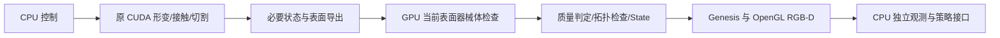
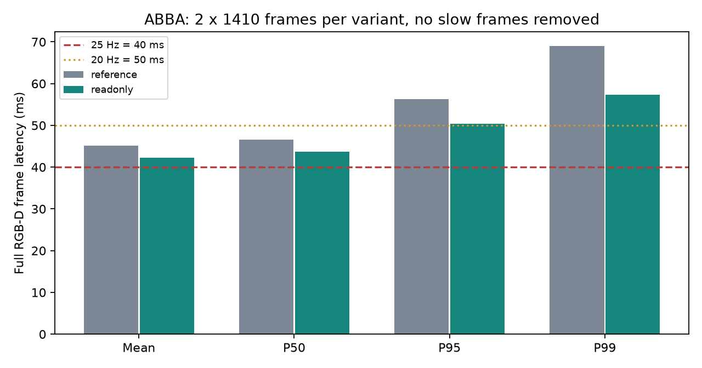
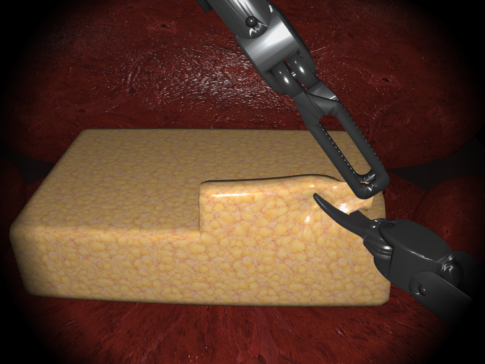

> GitHub 归档说明：本页结论保持原样。部分逐帧 JSON 链接已改为带原文件 SHA256 的指标摘要；原始 trace、编译库、环境和大型快照仅保留在服务器。详见 [归档范围](../../GITHUB_ARCHIVE.md)。

# 原生核心优化与完整交互性能复核（2026-11-04）

**仍未达到稳定 25 Hz；最慢切割窗口也尚未守住 20 Hz。** 本轮完整 1280×960 RGB-D 同库 ABBA 对照，参考版 **22.12 Hz**，保留的只读 GPU 检查版 **23.65 Hz**，观测吞吐改善 **6.90%**。最终 P95 **50.37 ms**、最慢连续 20 帧窗口 **18.42 Hz**。25 Hz 对应 40 ms，平均尚差 2.28 ms，P95 尚差 10.37 ms；不能用平均值宣布达标。

**最终保留 V8 只读诊断加速。原生形变、接触查询、夹取与切割求解全部保留参考实现。** 尝试的物理内核改写中，有些局部数值对照通过，但完整切割复测出现真实拓扑失败，已从 V8 实际删除。正式版本、上一轮已保留版本、依赖与网络配置均未改动。

## 1. 耗时最多在哪里

下面是**无 profiler 的真实完整帧**，每版两次、共 2820 帧。各行互斥，合计即平均 wall-clock 帧时间；`surface_export` 已包括在质量检查中，不重复相加。

|阶段|参考版 ms/帧|V8 ms/帧|V8 占比|
|---|---:|---:|---:|
|原生物理步（含其必需观测读回）|28.381|28.441|67.26%|
|质量检查与表面导出|4.482|2.451|5.80%|
|State 组装与抓取证据（非全量存档）|1.492|1.444|3.42%|
|完整 RGB-D、对齐与相机读回|9.221|8.507|20.12%|
|控制、策略观测复制与其它|1.627|1.440|3.41%|

**最大耗时为原生物理步 28.44 ms，占 67.3%。其次为 RGB-D 8.51 ms，占 20.1%。** 本轮保留改动直接针对质量检查，其墙钟减少 2.03 ms。原生物理平均 28.38→28.44 ms，未显示物理解算加速。渲染和其它部分存在运行间波动，不把这些波动全部归因于新代码。

实际物理热路径是项目自定义的 `LiverCudaSim` CUDA 求解器，入口为 `NativeEnvironment → NativeTissue → LCS_Step`；Genesis 在这条测试路径中主要承担可视化。不能用 Genesis 的 `n_envs` 性能替代该自定义求解器的证据。

当前同一帧仍按依赖顺序执行，没有将下一帧预测图像或旧状态混入当前观测。

切割阶段比全轨迹均值慢，三个切割阶段分别如下。V8 的纯物理平均已达 32.82–34.00 ms，再叠加渲染、检查与状态组装，40 ms 的预算很紧。

|阶段|版本|完整帧 ms|原生物理 ms|RGB-D ms|完整 Hz|
|---|---|---:|---:|---:|---:|
|incise_1|reference|51.005|33.193|9.563|19.61|
|incise_1|readonly|46.802|32.822|8.415|21.37|
|incise_2|reference|51.487|33.532|9.615|19.42|
|incise_2|readonly|47.825|33.623|8.685|20.91|
|incise_3|reference|51.799|33.560|9.766|19.31|
|incise_3|readonly|48.615|34.000|8.850|20.57|

[全部阶段原始汇总](results/stage-comparison.csv)。

## 2. 实际 GPU / CPU 时间线

最终 V8 使用 Nsight Systems 的 CUDA Graph **node** 追踪、NVTX、OpenGL 和 CPU thread clock，在第一次切割 frame 470–481 捕获 12 帧；保持原 graph 执行，不启用会绕开 graph 的 section-profiler。以下为**有采集开销的热点窗口**，不能据此计算正式 FPS，也不能与全轨迹均值直接相减。

|GPU 核|次数/帧|实际累计执行 ms/帧|
|---|---:|---:|
|`k_FindSurfaceBatched`|36|4.540|
|`k_CoarseAccumulateBoundCache`|36|3.842|
|`k_AssembleUnifiedInteractions`|192|2.407|
|`k_UnifiedManifold`|45|1.735|
|`void k_UnifiedVertex<`|96|1.727|
|`void k_MaterialStencilAssemble<`|3|1.112|
|`k_UnifiedTool`|27|1.087|
|`k_RepairMinimumVolume`|372|0.950|
|`k_MgGalerkin`|9|0.790|
|`k_BladeCoarse`|72|0.784|
|`k_CurrentSurfaceBodyCheck`（新只读检查）|1|0.008520|

表面接触查询、粗层形变项、接触约束装配是主要 GPU 热点。直接断边/重建小核不在主要热点前列；切割触发的接触重发现、修复与重新求解已记在相关大核中，不能据此把“全部切割代价”说成一个小核的耗时。

捕获窗口平均 wall **60.017 ms**；实际 CUDA 核并集 **30.492 ms**，DMA 并集 **0.425 ms**，memset **0.803 ms**；全部 CUDA 并集 **31.720 ms**。已记录 GL 工作并集 **4.348 ms**，CUDA+GL 并集 **36.067 ms**。并集用于避免重叠工作重复统计。

|CPU CUDA API 包络|wall ms/帧|期间同时有 CUDA 活动 ms|期间未记录 CUDA 活动 ms|
|---|---:|---:|---:|
|`cudaMemcpy_v3020`|25.935|23.503|2.432|
|`cudaGraphLaunch_v10000`|4.017|3.448|0.569|
|`cudaGraphExecDestroy_v10000`|2.800|2.499|0.302|
|`cudaLaunchKernel_v7000`|1.937|1.275|0.662|

例如 `cudaMemcpy` 的约 26 ms 包络大部分与 GPU 运算重叠，**不代表 DMA 花了 26 ms**。CPU thread time 包含驱动自旋；API 未覆盖 GPU 的剩余时间也不能全部判作纯 CPU 算术。未取得硬件占用率/显存带宽计数器或完整调度采样，不以寄存器数、NVML 百分比推断这些量。

新检查的 GPU 核仅 **8.52 µs/帧**；包含参数准备、调用、同步和读回的 CPU 包络约 **0.466 ms**。同条件早期参考窗口的 CPU 检查包络约 2.396 ms，实际完整帧质量阶段的减少约 2.03 ms。该阶段已经由 CPU 数组计算迁到当前 GPU 表面；必需的训练/渲染表面导出仍保留，没有把它从 FPS 口径中删掉。

[时间线 SVG](results/analysis-readonly-v8/timeline.svg) · [PNG](results/analysis-readonly-v8/timeline.png) · [Perfetto JSON](results/analysis-readonly-v8/timeline.json) · [详细统计](results/analysis-readonly-v8/summary.json) · [Nsight 原始捕获](results/readonly-v8-profile-trace.nsys-rep)。

## 3. 实施、验证和排除记录

|实验|修改与实际结果|最终处理|
|---|---|---|
|V1 接触临时记录|整条 retained 记录改为引用，延后输出构造；寄存器 168→156、栈 1872→1392 字节；全程逐项对照通过。完整 RGB-D 43.577→43.670 ms|无端到端收益，删除|
|V2 器械接触求值并行|把单 warp 中昂贵的逐接触力/Hessian 求值分散到更多 GPU 线程，最后保留原 32 lane 累加与四自由度求解；核合计约 1.104→0.602 ms；38,070 次器械状态对照零差异|组合在 V7 完整复测 frame 792 出现非流形边，未保留|
|V3/V4 查询删冗余|跳过胶囊分支不用的 retainedPlane/cache 计算，复用相同点的 SDF；V3 另试寄存器约束。局部接触对照零差异，但完整切割 frame 794 / 792 失败|删除；V3 还影响 18 个原函数编译结果，V4 移除约束后仍失败|
|V5 粗层共享归约|以投票替代单组件 CTA 的共享 CAS，混合组件回退原法；全程系数/状态对照通过；热点核约 3.838→3.852 ms|无 GPU 收益，删除|
|V6 受压边精确分支|仅在原应变必为零的压缩边避免除法，受拉边仍用原公式；到停止点系数零差异，但 frame 792 拓扑失败|删除|
|CPU 零接触提前确认|241 组返回值一致；真实切割表面原 2.211–2.222 ms，新 2.317–2.324 ms|回退开销更大，删除|
|V8 GPU 器械体诊断|直接读取 GPU 当前 expanded soup，保留顶点/质心/三边中点，原物理源文件和 330 个函数机器码不变|保留为独立、默认关闭的可选诊断加速；不宣称稳定 25 Hz|

不能因为同输入接触记录或梯度零差异，就推断整个浮点并行演化一定相同。失败版本的 CPU 与 GPU 拓扑复核一致；均定位到**四张三角形共用一条边，端点坐标完全一致**。本轮没有调小焊接容差，也没有关闭失败检查。完整因果链仍待确认，不能武断认定某个数学公式错误。

已提取无需 GPU 的静态最小复现：仅 4 张三角形，使用精确坐标也出现边关联度 4。[失败定位](results/failure-localization.json) · [最小网格清单](results/topology-mre/manifest.json) · [复现脚本](tools/reproduce_nonmanifold.py)。脚本退出成功表示“错误被重现”，不表示表面验收通过。

最终源代码实际移除了新增物理路径；V7 的单次 23.47 Hz 不进入最终通过性能表。失败结果仍存原始目录。[逐项实验记录](EXPERIMENTS.md)。

## 4. 最终完整 RGB-D 对照

一张 A100 GPU 1、一个进程/环境，A–B–B–A，每组 1410 帧。相同 seed=0、settled / wall-traction 场景、CPU 7/19/20/25、BLAS/OMP/OpenCV 单线程、dt=1/30、3 子步、8 次接触细化、同分辨率和模型参数。计入每步新 RGB、原始深度、RGB 对齐深度、有效性和 CPU 独立观测复制。没有并发编译或其它本轮 GPU 测试；所有慢帧保留。

|指标|同库原法 A|只读检查 B|
|---|---:|---:|
|平均 FPS / Hz|22.12|23.65|
|平均帧耗时 ms|45.202|42.284|
|P50 ms|46.543|43.728|
|P95 ms|56.244|50.367|
|P99 ms|68.957|57.334|
|最大帧耗时 ms|111.030|79.057|
|最慢连续 20 帧窗口 Hz|16.052|18.420|
|超过 50 ms 的帧数|571|157|
|超过 40 ms 的帧数|2343|1819|
|NVML 平均 GPU 利用率 %|67.68|72.00|
|采样峰值显存 MiB|2136|2136|

|原始轮次|Hz|P95 ms|完整性/本地检查|
|---|---:|---:|---|
|readonly-abba-0-reference-a|21.948|58.449|1410 / 通过|
|readonly-abba-1-readonly-a|23.779|49.722|1410 / 通过|
|readonly-abba-2-readonly-b|23.522|51.038|1410 / 通过|
|readonly-abba-3-reference-b|22.300|53.304|1410 / 通过|

NVML 按约 2 秒采样，均值只统计测量窗口；它是设备级利用率，**不是 SM occupancy**。显存峰值含显示进程和渲染资源。本轮利用 GPU 1 的空间足够，未出现显存上限问题。其它 GPU 未用于本轮仿真。[最终释放记录](results/gpu-final-release.csv)：0% 利用率、14 MiB，仅保留原显示开销。

初始化/重置不计稳态帧，但进入 1410 步后的慢帧全部计入。首帧或第一次切割时的编译/渲染开销没有删去。上轮报告约 23.03 Hz 是历史数，本轮收益按当前同库 ABBA 的 22.12→23.65 计算；渲染与其它阶段的波动也明确保留。

原生物理步分量 28.44 ms，其倒数约 35.16 次/秒；这只是阶段分量，包含该阶段读回，不能冒充端到端 FPS。

无渲染、保留完整检查/控制/CPU 观测的独立运行：**30.88 Hz**、平均 **32.38 ms**、P95 **39.26 ms**、最慢 20 帧 **23.26 Hz**。它不是完整 RGB-D FPS；原生物理阶段本身也不能与整个无渲染步速混称“纯物理 FPS”。

[汇总 JSON](results/final-summary.json) · [未过滤的帧时间图](results/figures/all-frame-times.svg) · [延迟对照图](results/figures/latency-comparison.svg)。

## 5. 正确性与交互边界

- **最终 V8 全流程**：1410 帧真实 RGB-D，加上 CPU/GPU 逐项诊断，三次切割完成；本地物理、拓扑、器械碰撞与范围检查全部通过。最终普通测速另外四组、共 5640 帧通过。
- **接触/流形**：50,780 个配对批次、1,542,147 条有效接触、7,705,424 条流形记录，记录、节点度、活动集合、种类顺序、积分权重零差异，无跳过/回退比较。
- **粗层缓存**：累加项 10,448,466,000 和步界项 10,448,466,000 与原计算逐项对照，差异为零。它是已有缓存的验证，不是本轮改了材料模型。
- **GPU 体检查**：最终二进制另测 241 组，含 181 组正接触；最大误差 **3.21e-10 m**。全 1410 帧 CPU/GPU 比较最大差 **2.78e-19 m**，验收判定零差异。50 µm 阈值邻域仅选择回 CPU 原法，不改变原 0.2 mm 验收限。
- **真实策略动作与切割**：seed=7、cut_ready，32 步操作触发真实 cut_onset；4 个当前状态下 RGB 逐像素一致、有效性一致、原始/对齐深度最大差 **1.49e-08 m**。保留的旧观测没有被后帧覆盖。
- **快照**：首次 GPU 检查分配、重复检查、渲染与 GPU 拓扑查询不改变物理存档；恢复后原生存档逐字节一致，恢复后仍能正常切割。错误诊断配置被拒绝。**不宣称未来轨迹确定性已经解决。**

[RGB-D 回归](results/readonly-v8-current-rgbd/result.json) · [快照回归](results/readonly-v8-snapshot/result.json) · [完整诊断](results/readonly-v8-full-rgbd-validation/result-summary.json) · [最终正接触测试](results/gpu-body-v8-synthetic/result.json)。

以上支持当前场景的局部对照，并不替代人工交互主观测评或整个物理域验收。新几何重复不稳定、纯摩擦准备失败、wall 器械碰撞检查失败、真实撕裂分离正对照未触发仍未解除；连续 S25 支撑绑定、随机化可见性及未来轨迹不确定性问题也未重新判为通过。**formal_physics_domain_approved=false；training_domain_approved=false。** 可选密集 S25 每像素支撑节点/权重标签未计入本轮 FPS，显示传输和录像编码也未计入。没有通过关闭这些既定测速项目中的必要计算来加速。

## 6. 实际代码改动与衔接

最终只修改/增加：

1. [gpu_body_check.cuh](native-readonly-v8/source/vendor/cuda/gpu_body_check.cuh)：直接处理 GPU 当前 expanded soup；三角形顶点、质心和三边中点完整保留。参数通过 kernel 参数传入，只读回小型结果；private raw CUDA scratch 不进入物理存档。
2. [dc_recon.cu](native-readonly-v8/source/vendor/cuda/dc_recon.cu) 与 [plugin_api.cpp](native-readonly-v8/source/vendor/src/plugin_api.cpp)：只读入口、当前点数一致性检查、清理和合成测试入口。
3. [Python 适配](python-gpu-check/endoscopic_tissue/training/gpu_body_check.py)：当前 surface 身份核对、数值与阈值邻域回退；不吞掉 CUDA 错误。
4. [quality.py](python-gpu-check/endoscopic_tissue/training/quality.py)：默认原检查，显式安装可选检查；[snapshot.py](python-gpu-check/endoscopic_tissue/training/snapshot.py)：绑定新源码与诊断模式。

`xpbd_solver.cu`、材料求解源文件、原接触查询、切割源文件、State ABI/物理存档代码保持参考内容；原 **330 个 GPU 函数机器码全部一致**。新 CUDA 核 1 个及其 double sqrt 帮助函数，不包含被排除的器械或材料分支。

RL/采样接口仍返回当前 step_id/native_tick 的 RGB-D 与独立 CPU 数组；没有改动作语义、物理 dt、重置或终止判定。每次 reset 后需要显式安装可选 GPU 检查，恢复快照前应安装与存档相同的诊断配置。采集时应将 DLL/源码 hash 与诊断模式一起记录；不将失败帧或未批准物理域数据当作通过。多 worker 训练吞吐和单环境显示实时性是不同指标，本轮没有用总吞吐替代单环境帧率。

[完整 SHA256 审计及开关](delivery/manifest.json) · [原生补丁](delivery/native-from-reference.patch) · [Python 补丁](delivery/python-from-reference.patch)。两份补丁 `git apply --check` 均通过；正式库 hash 仍是 `3950d621…`，未替换、未推送 GitHub、未安装/升级依赖、未修改网络/驱动/MPS/MIG/时钟。

## 7. 下一步的实施顺序

1. **先处理切割重建稳定性**：以本轮四三角形共边最小网格和对应失败快照为固定用例，追踪切割壁面面归属、去重与半边连接。不能通过降低焊接精度或放宽拓扑检查通过验收。当前四张面共享精确端点，单纯变焊接容差不能解决这组复现。
2. **再做原生重排**：优先针对 4.54 ms 查询、3.84 ms 粗层项、2.41 ms 装配。考虑活动记录稳定排序、固定材料 ID、确定性分组归约，再重新验证器械并行求值或更精确的几何算法。是否改善吞吐、是否消除失败均尚未验证，不能预报线性收益。
3. **再压端到端尾延迟**：保留当前画质和全部检查，针对 graph 生命周期、几何/图像复制、渲染 CPU 提交开销做同帧优化。优先测 critical path；不把同步包络全部算成可消除 CPU 时间，不用旧帧流水线掩盖交互延迟。
4. 当前可用优化仅在独立目录显式启用，先保持原版作回退。稳定 25 Hz、所有 S18–S25 物理验收与多 GPU 扩展分别验收。

复现入口和资源约束见 [README](README.md)。静态拓扑最小复现可直接执行 `python tools/reproduce_nonmanifold.py`，不使用 GPU。完整测试请用现有项目 Python 执行 `tools/reproduce.py --kind benchmark --variant readonly`；`--dry-run` 先输出实际参数。所有结果路径限制在本独立目录内。
