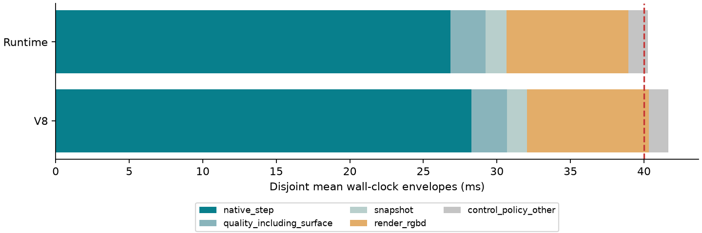
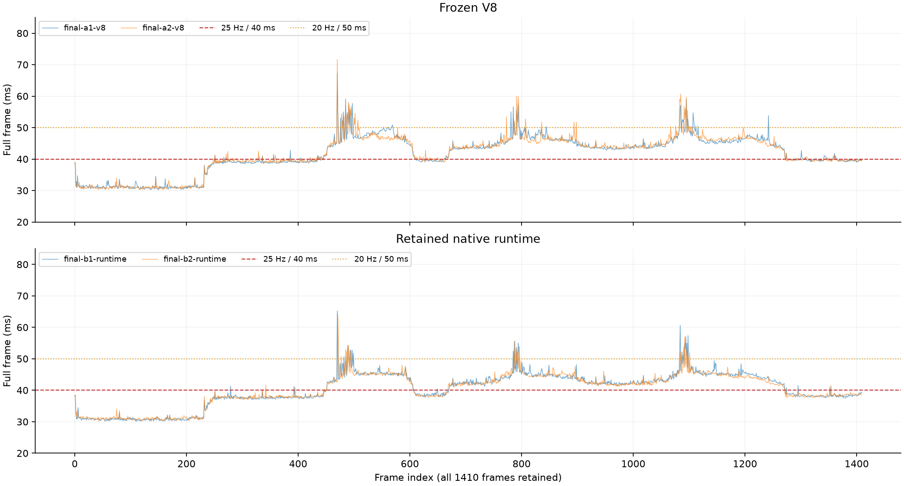
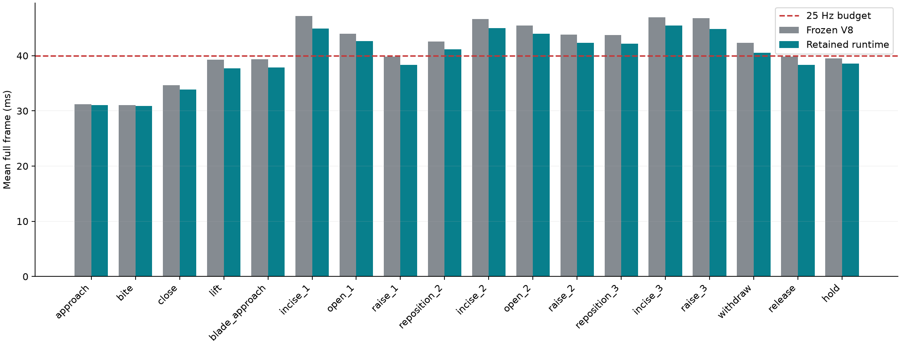
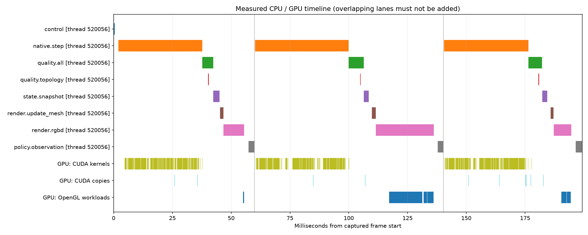

# 原生物理、接触与切割实时性优化（2026-11-04）

**最终完整 1280×960 RGB-D 平均 24.84 Hz，P95 46.24 ms，未达到稳定 25 Hz。** 同条件 V8/候选 ABBA 对照共 5,640 帧全部通过现有局部质量检查，端到端吞吐提高 3.45%，原生步耗时下降 5.08%。最慢连续 20 帧仍只有 19.61 Hz，**20 Hz 慢窗口底线也未全部通过**。

最大的耗时仍是原生步：26.84 ms，占整帧 66.7%；其中包含软组织形变、接触/约束、切割、最终整理及必要状态读回。三个切割阶段实际平均约 22 Hz，不能用全轨迹均值宣称切割达到 25 Hz。

**补充自由组织用例的严格跨轨迹复现未通过，冻结 V8 的重复运行同样未通过；这不构成全域交互无损证明，候选不作正式替换。**

当前候选唯一源码是 [native/source](native/source/)，唯一选定库是 `native/binaries/runtime-core.so`，SHA256 `8b24b3f7b6ec7f2d952437a2bf672a5d31604125ee881299450e3a4cca1691ec`。正式部署、`current/` 和冻结 V8 保持原状。运行入口见 [README](README.md)；淘汰尝试不进入该源码树。

## 1. 测量条件和真实帧预算

- 一张空闲 A100 80GB PCIe（GPU1，以 UUID 绑定），一个 wall-traction 环境，seed=0，完整 1410 步三刀轨迹。
- 原 1280×960 RGB-D，每个物理步返回当前帧到 CPU，并构造策略观察；保持原图像深度对齐、工具控制、拓扑、材料、器械碰撞和质量检查。
- 原 dt=1/30 s、3 子步、8 次接触细化，材料精度、网格和阈值不变；CPU 亲和 7/19/20/25，BLAS/OpenMP/OpenCV 单线程。
- 使用现有 CUDA 12.5.1、g++12、Release/sm80。编译与 GPU 测速分开，不安装升级依赖，不改网络、驱动、GPU 时钟、MPS/MIG，不打断其他任务。
- 初始化和 reset 单独计时；进入轨迹后的首帧、第一次切割和慢帧全部保留。
- 本口径为**离屏 RGB-D、CPU 读回及策略观察端到端帧**；桌面显示/视频编码/传输、密集 S25 特权像素支撑标签和双 worker 吞吐不在本次测速中。不能据此宣称完整桌面交互或双 worker 每个都达 25 Hz。

以下是四组普通运行的互斥 wall-clock 包络，子项未重复相加；`surface_export` 已包含在质量/导出项中。

|整帧模块|V8 ms|候选 ms|候选占比|
|---|---:|---:|---:|
|原生步：形变、接触、切割及必要读回|28.274|26.837|66.7%|
|质量检查与表面导出|2.407|2.398|6.0%|
|状态快照组装|1.373|1.432|3.6%|
|视觉更新、RGB-D 渲染/处理/读回|8.277|8.277|20.6%|
|控制、策略观察与其余 Python|1.309|1.309|3.3%|
|总计|41.641|40.253|100%|



### 同条件最终 ABBA

A 为冻结 V8，B 为本轮最终库。均开启 V8 原有的 GPU 只读质量检查，避免把上一轮检查加速混入本轮收益。每组 1410 帧，四组均完整通过。两次复测样本有限，以下是观测收益，没有建立跨服务器负载的置信区间。

|顺序|平均 Hz|平均 ms|P50 ms|P95 ms|最慢 20 帧 Hz|原生步 ms|
|---|---:|---:|---:|---:|---:|---:|
|[final-a1-v8](results/final-a1-v8/result.json)|24.03|41.61|43.32|49.25|19.36|28.35|
|[final-b1-runtime](results/final-b1-runtime/result.json)|24.82|40.29|41.96|46.53|19.61|26.86|
|[final-b2-runtime](results/final-b2-runtime/result.json)|24.87|40.21|41.68|46.08|20.44|26.81|
|[final-a2-v8](results/final-a2-v8/result.json)|24.00|41.67|43.48|48.45|18.96|28.20|

|合并指标|V8，两次共 2820 帧|候选，两次共 2820 帧|
|---|---:|---:|
|平均 Hz|24.01|24.84|
|平均 / P50 ms|41.64 / 43.37|40.25 / 41.78|
|P95 / P99 ms|48.90 / 55.04|46.24 / 52.38|
|最大帧 ms|71.67|65.19|
|超过 40 ms / 50 ms 帧数|1669 / 97|1529 / 51|
|最慢连续 20 帧 Hz|18.96|19.61|
|GPU 平均采样利用率|72.9%|72.3%|
|采样峰值显存 MiB|2136|2136|
|平均采样功率 W|104.5|107.0|

GPU 遥测每 2 秒采样，只统计实际 1410 帧测量窗口。NVML 的 GPU 利用率不是 SM 占用率，内存控制器百分比不是实际显存带宽。未改驱动权限；Nsight Compute 性能计数器受限，未取得占用率/带宽的硬件计数。



|真实切割阶段|V8 完整帧 ms / Hz|候选完整帧 ms / Hz|候选原生步 ms|候选 P95 ms|
|---|---:|---:|---:|---:|
|incise_1|47.20 / 21.19|44.91 / 22.27|31.05|51.71|
|incise_2|46.62 / 21.45|45.00 / 22.22|31.41|48.39|
|incise_3|46.92 / 21.31|45.49 / 21.98|31.90|50.88|



## 2. GPU 与 CPU 时间线：真正的热点

使用 Nsight Systems 的 CUDA Graph **node** 追踪、NVTX、OpenGL、Python 分层包络和 thread clock，在首次切割 frame 470–481 捕获 12 帧；保留原 graph 路径，没有启用会绕开 graph 的 section-profiler。**该窗口有采集开销，不能作为正式 FPS**；它与全轨迹平均也不在同一统计范围。

|实测 GPU 热点|V8 ms/帧|最终候选 ms/帧|候选调用/帧|
|---|---:|---:|---:|
|表面接触查询|4.415|4.693|36.00|
|材料/接触粗层累积|3.834|2.834|33.00|
|联合接触/抓取约束装配|2.408|2.388|192.00|
|接触流形|1.732|1.715|45.00|
|FEM 顶点局部求解|1.727|1.738|96.00|
|材料稀疏模版|1.119|1.129|3.00|
|耦合器械求解|1.089|1.049|27.00|
|体积安全修复|0.920|0.943|372.00|
|多重网格粗化|0.970|0.974|12.00|
|只读抓取状态反馈|0.228|0.026|2.00|

同一查询时刻的记录逐位比较与不同完整轨迹的耗时比较是不同证据。浮点并行归约及切割使两次轨迹并非逐状态完全相同；不将某个查询核的跨轨迹时间差直接归因于单条指令变化。

直接断边、连通性、重建/整理核的互斥实测分组见 kernel-groups；它们的合计小于形变/接触联合求解。切割还会触发接触重发现、体积修复和重新求解，后者计在对应求解核中。因此不能把直接断边小核合计当成“全部切割成本”，也不能预期单换切缝几何算法便消除整段切割慢帧。

|时间轴（同一采集窗口）|V8 ms/帧|最终候选 ms/帧|
|---|---:|---:|
|instrumented wall-clock|58.502|56.928|
|CUDA kernel 实际活动并集|30.321|28.818|
|GPU memcpy 实际活动并集|0.420|0.459|
|GPU memset 实际活动并集|0.802|0.825|
|CUDA 全部活动并集|31.542|30.101|
|OpenGL 实际活动并集|4.548|4.683|
|CUDA/OpenGL 合并活动并集|36.090|34.785|

这些并集彼此存在包含/重叠关系，不能逐行加总。CPU thread time 包含驱动自旋，不能把它直接当作 Python 算术时间。

|CPU 包络，候选 nsight 窗口|inclusive wall ms/帧|thread CPU ms/帧|
|---|---:|---:|
|api.LCS_Step|32.814|32.814|
|native.step|35.085|35.083|
|native.observe|1.125|1.125|
|quality.all|4.791|4.752|
|state.snapshot|1.979|1.972|
|vision.all|12.083|12.041|
|policy.observation|1.712|1.713|

父子 CPU 包络不能相加。Nsight Python tracing 和 cProfile 会增加 CPU 开销；未采集完整 CPU 调度事件，未把“API 未覆盖 GPU 的剩余时间”冒充精确纯 CPU 算术或睡眠等待。

|候选 CPU API|调用/帧|API wall ms|其中覆盖 CUDA 活动 ms|未覆盖 CUDA 活动 ms|
|---|---:|---:|---:|---:|
|cudaMemcpy_v3020|55.50|27.362|24.471|2.891|
|cudaGraphLaunch_v10000|18.00|3.617|3.180|0.438|
|cudaLaunchKernel_v7000|766.00|1.953|1.228|0.726|
|cudaMemsetAsync_v3020|191.50|0.527|0.338|0.189|
|cudaGraphExecUpdate_v10020|2.00|0.369|0.149|0.220|
|cudaFree_v3020|1.50|0.238|0.104|0.135|
|cudaMemcpyAsync_v3020|33.00|0.183|0.159|0.024|
|cudaGraphDestroy_v10000|2.00|0.113|0.027|0.086|
|cudaMalloc_v3020|1.50|0.101|0.000|0.101|

`cudaMemcpy` API 的几十毫秒包络大部分在等此前 GPU 计算；GPU DMA 的实际活动见上表及 copies 记录，二者不能相加。原 V8 图销毁 API 的 3.510 ms 中，有 3.126 ms 与 CUDA 活动重叠，不能声称图复用独自节省了 3.510 ms。

[基线时间线 JSON](results/analysis-baseline/timeline.json) · [最终时间线 JSON](results/analysis-final/timeline.json) 可用 Perfetto/Chrome tracing 打开；nsys-rep 和 sqlite 保留用于 Nsight Systems。



## 3. 已保留的原生改动

1. **CUDA Graph 生命周期复用（bit 256）**。三个 prelude/fragment graph 优先做 `cudaGraphExecUpdate`，CUDA 明确拒绝更新时执行原销毁/重建回退；原统一求解 graph 保留既有更新逻辑。V1 单独比较时 332 个原 GPU 函数机器码一致。最终两次测速分别 96/97、84/85 次更新成功，各 1 次正常重建回退。尾延迟收益没有按整个销毁包络重复计算。
2. **原融合粗层核的编译寄存器预算（bit 8192）**。[coarse_occupancy.cuh](native/source/vendor/cuda/contact/coarse_occupancy.cuh) 保持原材料能量、九个系数、归约算法、接触与抓取项。原核 96 registers，保留候选 80 registers；栈 64→120 B，并非所有资源都下降。保留 `__launch_bounds__(256,3)` 的原因是完整实测和系数逐位对照，而非把寄存器数当作占用率测量。
3. **原应用守卫禁止的粗层修正门控（bit 32768）**。[zero_mode_gates.cuh](native/source/vendor/cuda/zero_mode_gates.cuh) 用真实的有效抓取、附着/固定状态和每个可动组件判定；只有全部组件满足原最终守卫的禁止条件，才省掉该段修正。未持稳、无支撑或无效根走原计算；不按瞬时接触猜测永久支撑。基函数权重和粗层清理继续执行，避免破坏材料共享工作区。决策并入原有同步查询，没有新增 CPU 等待。诊断模式实际执行被省略的原步骤并逐坐标位比较。
4. **只读抓取反馈并行几何 + 原顺序 double 累加（bit 2048）**。[runtime_grip_feedback.cuh](native/source/vendor/cuda/grasp/runtime_grip_feedback.cuh) 将点几何计算分配给 GPU 线程，最后按原顺序累加 double 并计算相同反馈。它没有替换夹持力、摩擦或 Gaussian grasp 求解。完整回归与原只读核逐位比较三个返回值。

这四项组合为 core mode `43264`，在初始化前显式设置；默认 0 保留参考路径，运行中更换模式被拒绝。graph key 包含有效门控和验证状态，避免复用不匹配的捕获序列。新私有 scratch 不进入原物理存档，快照额外绑定运行模式及工具源码散列。

原生源码仅修改三个已有文件：`xpbd_solver.cu`、`coarse_bound_cache.cuh`、`plugin_api.cpp`，新增上述三个头文件。其余 50 个原文件散列不变，包含原 FEM 能量/硬化/阻尼、摩擦/抓取、`physics.cu`、`cut.cu`、重建、物理状态 ABI 和 CMake 编译配置。Python 运行包 333 个文件均未改动，测试侧只添加模式绑定。

完整最终库机器码审计：332 个原函数无缺失，其中 17 个因同一 CUDA 翻译单元重新编译而机器码有变化；新函数 7 个。**本最终库不能沿用 V1 的“所有原函数机器码不变”结论**，所以重新执行完整数值与实切回归。详见 [SASS 审计](results/sass-final-from-baseline.json)、[原生补丁](delivery/native-from-v8.patch) 与 [交付清单](delivery/manifest.json)。

## 4. 已尝试并淘汰的方向

|尝试|实际证据|处理|
|---|---|---|
|直接构造 GPU 接触记录|栈 1872→656 B，47,968 有效接触逐项无差异；查询+提交 4.743+0.117 ms，高于参考 4.415 ms|移除|
|粗层材料/接触拆成两个核|短程对照和完整轨迹通过；原生步 29.115 ms，比图复用参考 28.401 ms 更慢|移除|
|观察接口合批读回|498 次所有字段逐字节一致；完整 23.58 Hz，无稳定收益；同 V6 库合批 24.54 Hz、原接口 24.68 Hz|移除 native 接口，保留历史补丁/二进制|
|粗层 64 寄存器预算|完整 24.40 Hz，但原生步 27.662 ms，高于 80 寄存器版本 27.462 ms；P95/最慢窗口也较差|移除该编译变体|
|原接触查询 32 / 128 线程|完整三刀均通过，分别 24.35 / 24.34 Hz；64 线程同库为 24.68 Hz|保持 64|
|夹爪/刀刃编译期查询特化|短程逐位对照通过；完整原生步 26.981 ms，参考 V6 为 26.889 ms；总帧轻微变快没有原生步收益支撑|移除|

以上是探索运行，时间先后不同，不能替代最后 ABBA 的收益估计。所有原始结果及失败构建日志保留；最终源码不包含直接记录、拆核、合批读回、64-register 或查询特化实验。

## 5. 最终冻结库正确性回归

|检查|实际执行量与结果|
|---|---|
|普通完整三刀对照|4 组，共 5,640 帧，原局部质量检查全部通过|
|原接触查询逐位对照|51,200 批，1,926,011 有效记录；记录、degree、活动集合、有效性及跨 kind 顺序差异均 0|
|接触流形逐项对照|64,110 批，9,203,836 记录；记录、degree、积分权重及映射差异均 0|
|粗层系数与边界输出|累积项 10,491,684,000，边界项 10,491,684,000；目标、九个系数、边界比例位差异均 0，非平凡约束比例已实际覆盖|
|省略原步骤的零位置变化证明|原 rigid 阶段 14,136 次、translation 阶段 4,230 次，共 4,190,202,900 坐标值，位差异均 0|
|只读夹持反馈|1,178 次原核对照，三值位差异 0|
|CPU/GPU 器械体检查|1410 帧，数值/判定差异 0；最大误差 2.22e-16 原生 cm|
|真实策略动作、RGB-D|seed=7，32 步，真实 cut_onset；4 个同当前状态 RGB/有效性逐像素一致，最大对齐深度差 1.49e-08 m|
|状态所有权|保留的旧观察未被后续帧覆盖；诊断/渲染未改变物理存档|
|实际切割快照|恢复后原生存档逐字节一致；恢复后一步质量通过；错误诊断/核心模式快照与运行中模式变化被拒绝|
|已有 CPU 契约回归|136 项全部通过，显式隐藏 CUDA|
|冻结参考保护|原生 53 + Python 333 个文件及 V8 库散列一致，current 链接未改|

数值正计数对照和普通测速分开运行。全程对照会执行原/新计算及大规模记录比较，其约 15.53 Hz **不是**优化后的普通运行速度。

### 不把局部通过扩大成全物理无损

|普通 ABBA 物理指标|V8|候选|
|---|---:|---:|
|最小体积比|0.149999216|0.149998829|
|最大无效四面体数|0|0|
|最大非预期愈合边数|0|0|
|最大非预期邻接变化数|0|0|
|最大 blade-body 深度 mm|0.0944818556|0.0626842339|
|最大 wrist 深度 mm|0|0|
|最小器械距离 mm|-0.00396900977|-0.0182454215|

以上使用原阈值；小的负器械距离表示原容差内的接触重叠，不是“完全没有穿透”。两组累计新切边数分别为 204 和 195；同一版本的重跑也不是逐未来状态完全确定，不能将同一当前状态下的像素/算子对照表述为跨轨迹逐像素或切割结局完全相同。现有指标未发现局部交互质量退化，但全任务、人机操作手感和未来轨迹确定性没有因此获批。

### 自由组织回退及未通过的严格轨迹复现

补充采用 2,925 节点、无固定/无抓取的小块组织，20 步自由下落约 1 m；仅用于检查回退覆盖与重复性，不属于性能或真实撕裂正对照。两次开启门控的运行，各有 63 个子步均执行原 rigid/translation 路径，省略次数均为 0。六次运行材料检查无无效四面体，最低体积比为 0.959608。

|对照|最大节点坐标差 mm|1 μm 轨迹对照|
|---|---:|---|
|冻结 V8 自身重跑|0.839|未通过|
|候选关闭门控，自身重跑|1.373|未通过|
|候选开启门控，自身重跑|0.985|未通过|
|候选门控关闭/开启|1.576|未通过|

参考重跑也有相同量级差异，支持“既有跨轨迹非确定性仍存在”的判断；样本有限，不能排除候选增加差异的可能。分支覆盖通过与严格轨迹复现失败分别记录，原 1 μm 对照没有放宽为通过。本轮不能批准自由碎片全域无损或未来轨迹确定性。见 [自由组织控制实验](results/free-component-repeat-control/result.json) 与 [完整轨迹数组](results/free-component-repeat-control/positions.npz)。

首个补充脚本把 `Observation.nodes` 误写为 `positions`，修正后另存重跑；原失败日志保留。其后的门控开/关 1 μm 对照是真实未通过项，亦保留在 [原始失败记录](results/free-component-fallback-checked/result.json)，未用字段修正掩盖该失败。

以下既有失败继续保留：新几何重复运行不稳定、纯摩擦准备失败、wall 器械碰撞检查不通过、真实撕裂分离正对照未触发；密集 S25 支撑节点标签的完整验收也未被本轮 RGB-D 测试覆盖。`formal_physics_domain_approved=false`、`training_domain_approved=false`、`stable_25hz_approved=false`。

## 6. FEM 变体与下一步应优先解决什么

实际热路径不是仅凭文件名所暗示的简单 XPBD 弹簧。源码是 Stable Neo-Hookean 型四面体 FEM，加入项目自定义拉伸硬化、压缩屏障及增量应变阻尼，结合着色 vertex/tool block descent、PCG 与聚合多重网格。Genesis 在本测量路径主要提供视觉场景，真实形变/接触/切割在自定义原生库内。原理可参照 [Stable Neo-Hookean 原论文](https://graphics.pixar.com/library/StableElasticity/paper.pdf) 与 [Vertex Block Descent 原论文](https://graphics.cs.utah.edu/research/projects/vbd/vbd-siggraph2024.pdf)；这些文献不替代对本项目扩展项的验证。

1. **继续针对表面查询的重型 GPU 状态与实际输入分布做改造**。它是当前最大单项，GPU 时间线有直接证据。已经淘汰局部栈缩小和分支特化的无效尝试；后续候选应以同输入 CCD/持久见证/预载接触逐位对照及完整多刀回归为门槛。不得取消 retained witness、有限刀刃 footprint 或 CCD 来虚增 FPS。
2. **先收敛切割重建与非确定性边界，再做更深层归约/融合**。现有大核融合、分块/粗层归约会改变浮点调度与轨迹，上一轮已有真实非流形失败证据。粗层系数和接触局部对照通过仍不足以证明所有几何无损；应保留已知失败快照与四三角形共边最小复现，并扩大独立新几何/无支撑片段验证。
3. **联合材料/接触装配是下一组热点**。保持原能量和自由度，评估跨颜色或多重网格的工作区/启动融合，必须证明全局依赖与更新顺序正确。尚未实现和验证新的 persistent/cooperative kernel 或 FEM 全局 Newton-Krylov 变体，不能写成已加速。
4. **端到端还需要约 5–7 ms 的切割帧预算改善**。当前普通切割均值约 45 ms，原生步约 31–32 ms，再加 8 ms 视觉和必要检查。只让整体平均再快 0.253 ms 并不能实现稳定 25 Hz；候选 P95 还需降低 6.24 ms，第一刀阶段 P95 缺口更大。单纯提高 NVML 利用率或增加 worker 不能消除这个单环境控制延迟。

替换为线性/共旋或投影动力学可能改变牵拉、夹持、预载切入、压缩和断裂响应。本轮没有把替换材料模型的理论潜力当成已验证结果；保留的是对现有模型的执行优化。真正的 FEM/夹取/切割算法替换仍需用相同力位移、保持/滑脱、切入阈值、断裂与安全范围基线验收后另行集成。

CUDA graph 更新与拒绝回退遵循 [NVIDIA 官方动态图更新说明](https://developer.nvidia.com/blog/employing-cuda-graphs-in-a-dynamic-environment/)。本机实际工具链为 CUDA 12.5.1，未因参考文档升级。

## 7. 可复测入口与证据

```bash
P=/srv/disk2/hryang/genesis-exec
E="$P/parallel_simulation_tests/20261103-s18-s25/profiling/native-core-runtime-20261104"
PY="$P/envs/genesis-py311-cu125-v1/bin/python"
"$PY" "$E/tools/reproduce.py"                              # 只验散列，不启动 GPU
"$PY" "$E/tools/reproduce.py" --run benchmark --name my-full-frame-run
"$PY" "$E/tools/reproduce.py" --run validate --name my-numerical-proof
"$PY" "$E/tools/reproduce.py" --run rgbd-validated --name my-rgbd-check
"$PY" "$E/tools/reproduce.py" --run snapshot --name my-snapshot-check
```

每次结果名必须未使用；保留原 GPU 资源守卫，顺序执行。`build.py --label NEW_LABEL` 在本目录构建，不覆盖选定冻结二进制。不要把 `native/build/lib` 中的某次临时构建当成当前选定库；[manifest](delivery/manifest.json) 绑定唯一源码、工具、参数和库。

- [普通对照汇总](results/final-comparison.json) · [CSV](results/final-metrics.csv) · [探索运行](results/exploratory-comparison.json)
- [最终全程数值对照](results/final-proof/result.json) · [实切 RGB-D](results/final-rgbd-proof/result.json) · [快照](results/final-snapshot/result.json)
- [基线 Nsight 分析](results/analysis-baseline/summary.json) · [最终 Nsight 分析](results/analysis-final/summary.json) · [GPU kernel 分组](results/analysis-final/kernel-groups.json)
- [自由组织回退/重复性未通过记录](results/free-component-repeat-control/result.json)
- [完整运行队列](results/final-queue.json) · [CPU 回归](results/cpu-regression.json) · [保护审计](results/protected-baseline-audit.json)

本轮已完成实际原生改动、逐项淘汰、完整对照及回归；稳定 25 Hz 和完整物理/训练域仍未通过，不替换正式版本。
